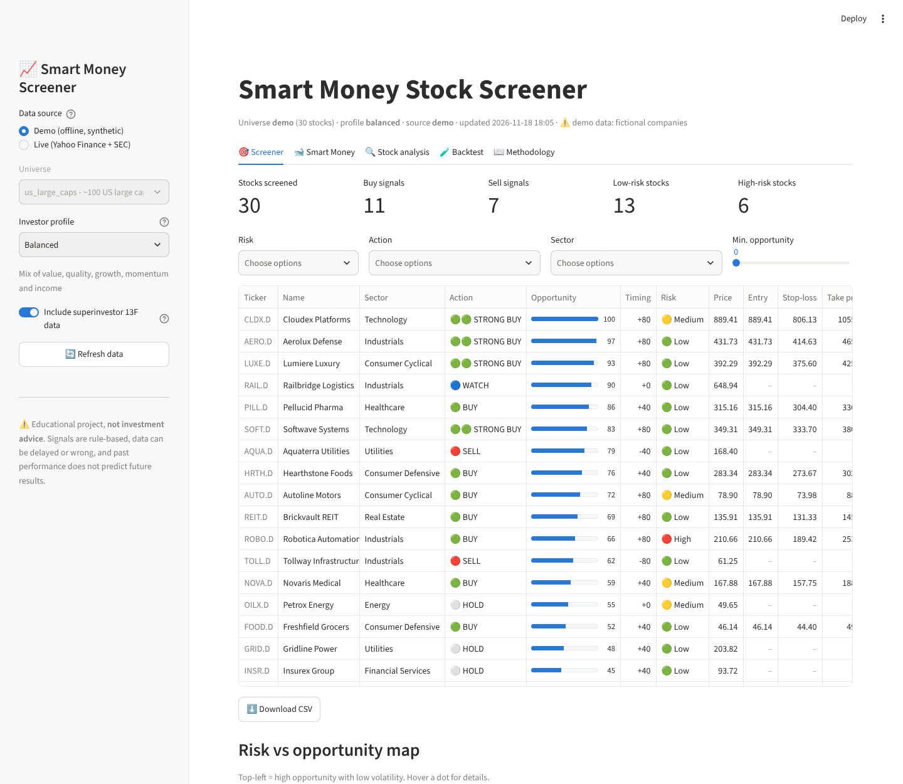
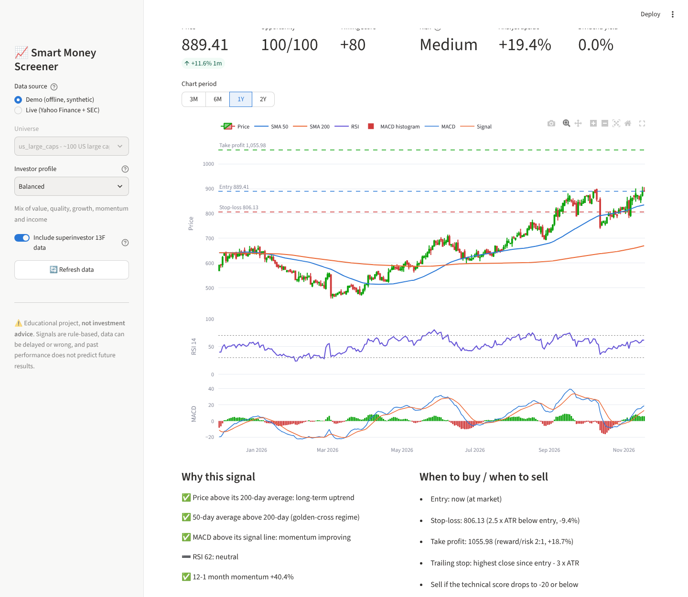
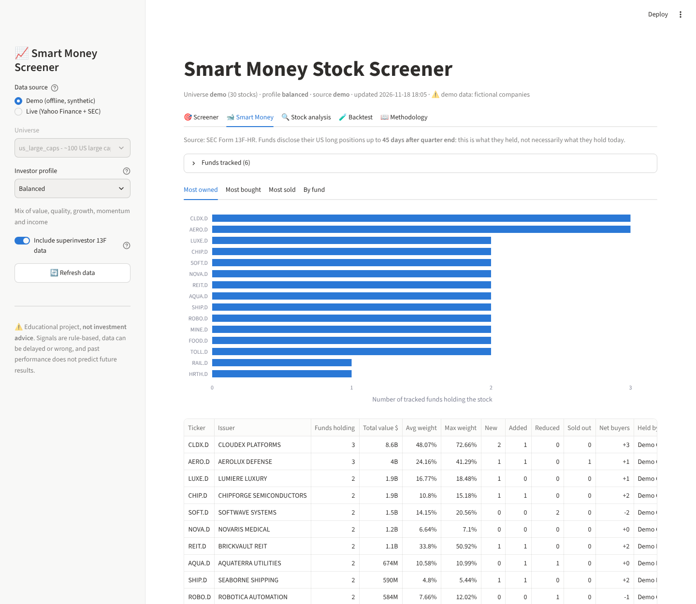
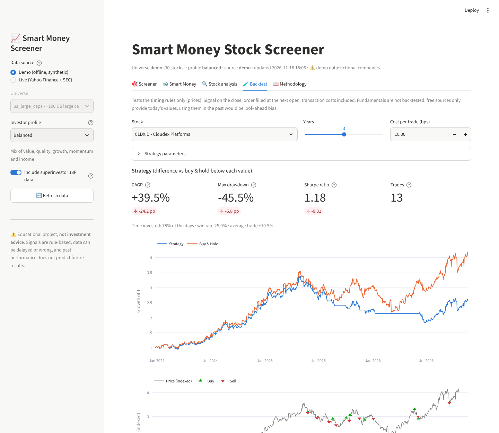

# 📈 Smart Money Stock Screener


[](https://github.com/xVenomme/smart-money-screener/actions/workflows/ci.yml)

[](https://smart-money-screener.streamlit.app)

**🚀 Live demo: [smart-money-screener.streamlit.app](https://smart-money-screener.streamlit.app)**

A stock screener that answers four questions:

1. **What are the big investors buying?** Holdings and quarter-over-quarter moves of well-known
   superinvestors (Berkshire Hathaway, Pershing Square, Appaloosa, Druckenmiller, Li Lu, Baupost...),
   read directly from their SEC 13F filings.
2. **Which stocks look like the best opportunities?** A factor score (value, quality, growth, momentum,
   income, analyst upside, smart money) with five investor profiles, including an *income* profile for
   dividend investors.
3. **How risky is each stock?** A transparent **Low / Medium / High** classification based on volatility,
   beta, drawdown, leverage and size.
4. **When to buy and when to sell?** Rule-based timing signals with **entry price, ATR stop-loss, take
   profit and exit rules**, plus a **backtest** of the same rules against buy & hold.



> ⚠️ Educational project, **not investment advice**. Signals are rule-based, free data sources can be
> delayed or wrong, and past performance does not predict future results.

---

## Features

| | |
|---|---|
| 🐋 **Smart money** | Parses Form 13F-HR XML from SEC EDGAR, maps CUSIPs to tickers via OpenFIGI, and classifies every position as NEW / ADD / HOLD / REDUCE / SOLD. Consensus tables show *most owned*, *most bought* and *most sold* stocks. |
| 🎯 **Opportunity score** | Cross-sectional percentile ranking of 15+ metrics grouped into 7 factors. Profiles: `balanced`, `income`, `growth`, `value`, `smart_money`. Dividend yield traps (payout > 100%) are penalised. |
| 🚦 **Risk classes** | Points-based system with fixed, documented thresholds. Missing data never counts as "safe". |
| ⏱️ **Buy / sell signals** | Five-vote technical score (trend, golden/death cross, MACD, RSI, 12-1 momentum) combined with the opportunity score into `STRONG BUY` … `STRONG SELL`. Stops are wider for riskier stocks. |
| 🧪 **Backtest** | Signal on the close, fill at the next open, transaction costs, trailing stop. A unit test proves there is **no look-ahead bias**. |
| 🖥️ **Two interfaces** | Interactive Streamlit dashboard and a `screener` command line tool. |
| 🔌 **Offline demo mode** | 30 fictional companies with synthetic but realistic data: the app and the test suite run without internet or API keys. |
| 🌍 **Universes** | ~100 US large caps, the full S&P 500, Italian FTSE MIB blue chips, or any CSV of tickers. |

## Quick start

```bash
git clone https://github.com/xVenomme/smart-money-screener.git
cd smart-money-screener
python -m venv .venv
source .venv/bin/activate            # Windows: .venv\Scripts\activate
pip install -e ".[dev]"

streamlit run app.py                 # opens http://localhost:8501
```

The dashboard starts in **Demo** mode. Switch to **Live** in the sidebar to download real data from
Yahoo Finance and the SEC (the first run takes a few minutes, then everything is cached in `.cache/`).

For live 13F data, the SEC asks automated clients to identify themselves:

```bash
export SEC_USER_AGENT="Your Name your.email@example.com"     # PowerShell: $env:SEC_USER_AGENT="..."
export OPENFIGI_API_KEY="..."                                 # optional, free key = faster CUSIP mapping
```

## Command line

```bash
screener scan --demo                                  # offline demo
screener scan -u us_large_caps -p income --risk Low   # best low-risk dividend ideas
screener scan -u italy_ftse_mib --action BUY "STRONG BUY" --csv buys.csv
screener scan -u sp500 --smart-money --top 30         # S&P 500 + superinvestor data
screener smart-money --top 25                         # most owned / bought / sold by the funds
screener smart-money --fund "Berkshire"               # one fund's portfolio and changes
screener plan MSFT                                    # entry, stop-loss, target and reasons
screener backtest NVDA --years 5 --cost-bps 10        # timing rules vs buy & hold
screener universes                                    # list available universes
```

Every threshold and weight lives in [`config.yaml`](src/screener/resources/config.yaml); pass your own
file with `--config my.yaml` (CLI) or the `SCREENER_CONFIG` environment variable (dashboard).

## How it works

```
 universe ──► prices + fundamentals ──► indicators & metrics ──┬─► opportunity score (what)
 (CSV/S&P)    (Yahoo, cached)          (SMA, RSI, MACD, ATR,   ├─► risk class (how risky)
                                        vol, beta, drawdown)   └─► timing score (when) ──► action + trade plan
 SEC 13F ──► parse XML ──► CUSIP→ticker ──► consensus ─────────────► smart-money factor
```

| Action | Rule |
|---|---|
| **STRONG BUY** | timing ≥ 60, opportunity ≥ 75, RSI ≤ 70 |
| **BUY** / **BUY ON PULLBACK** | timing ≥ 20 and opportunity ≥ 50 (pullback if RSI > 70) |
| **WATCH** | good company (opportunity ≥ 60) but no uptrend yet |
| **HOLD** | nothing compelling either way |
| **SELL** / **STRONG SELL** | timing ≤ −20 (strong: ≤ −60 and weak opportunity) |

For buy signals: **stop-loss** = entry − k × ATR (k = 2 / 2.5 / 3 for Low / Medium / High risk),
**take profit** = 2 × the risk taken, plus a trailing stop and a long-term exit below the 200-day average.

The full methodology, formulas and limitations are in **[docs/METHODOLOGY.md](docs/METHODOLOGY.md)**.

## Screenshots

| Stock analysis | Superinvestors (13F) |
|---|---|
|  |  |



*Screenshots use the offline demo data (fictional companies).*

## Project structure

```
smart-money-screener/
├── app.py                         # Streamlit dashboard
├── src/screener/
│   ├── cli.py                     # `screener` command
│   ├── screener.py                # pipeline orchestrator
│   ├── smart_money.py             # 13F consensus & quarter-over-quarter changes
│   ├── config.py, cache.py
│   ├── analysis/                  # pure functions, no I/O
│   │   ├── indicators.py          # SMA, EMA, RSI (Wilder), MACD, ATR
│   │   ├── metrics.py             # returns, volatility, beta, drawdown, Sharpe, CAGR
│   │   ├── scoring.py             # factor percentiles & opportunity score
│   │   ├── risk.py                # Low / Medium / High classification
│   │   ├── signals.py             # timing score, actions, trade plans
│   │   └── backtest.py            # next-open execution, costs, trailing stop
│   ├── data/
│   │   ├── base.py                # provider interface (Protocol)
│   │   ├── yahoo.py               # live data (yfinance) with retries & cache
│   │   ├── demo.py                # deterministic synthetic market
│   │   ├── sec13f.py              # EDGAR client & information-table parser
│   │   ├── openfigi.py            # CUSIP → ticker
│   │   └── universe.py
│   └── resources/                 # config.yaml, funds.yaml, universe CSVs
├── tests/                         # 54 tests, run offline (demo data + 13F XML fixtures)
├── docs/METHODOLOGY.md
└── .github/workflows/ci.yml       # lint + tests on Python 3.10–3.13
```

## Engineering notes

- **Testable by design**: analytics are pure functions; data sources implement one `Protocol`, so the
  same pipeline runs on live Yahoo data or on the deterministic demo market.
- **No look-ahead bias**: indicators and backtest decisions are verified to be unchanged when future data
  is appended; orders fill at the next open, never on the signal's own close.
- **Real-world data quirks handled**: 13F values reported in thousands instead of dollars (detected from
  the implied share price), duplicate CUSIP rows, options and bonds in filings, Yahoo's changing
  dividend-yield units.
- **Polite API usage**: SEC rate limiting and User-Agent, OpenFIGI batching, retries with backoff, disk
  cache with TTL (filed 13F reports are cached forever).

## Limitations

- 13F filings arrive up to 45 days after quarter end and only show long US positions.
- Fundamentals are a current snapshot, so only the price-based timing rules can be backtested honestly.
- A universe built from today's index members has survivorship bias.
- The opportunity score is relative to the universe screened.

## Roadmap

- [ ] Portfolio-level backtest (top-N stocks rebalanced monthly)
- [ ] Point-in-time fundamentals for a full factor backtest
- [ ] E-mail / Telegram alerts when a signal changes
- [x] Public demo on Streamlit Community Cloud

## 🇮🇹 In breve

Screener azionario in Python: legge dai filing 13F della SEC cosa comprano i grandi investitori, assegna
a ogni titolo un punteggio di opportunità (con un profilo *income* per chi cerca rendita da dividendi),
lo classifica per rischio basso / medio / alto e genera segnali di acquisto e vendita con prezzo di
ingresso, stop-loss e target, verificati con un backtest senza look-ahead bias. Dashboard Streamlit e
CLI, modalità demo offline, 54 test automatici e CI su GitHub Actions.

## License

[MIT](LICENSE)
